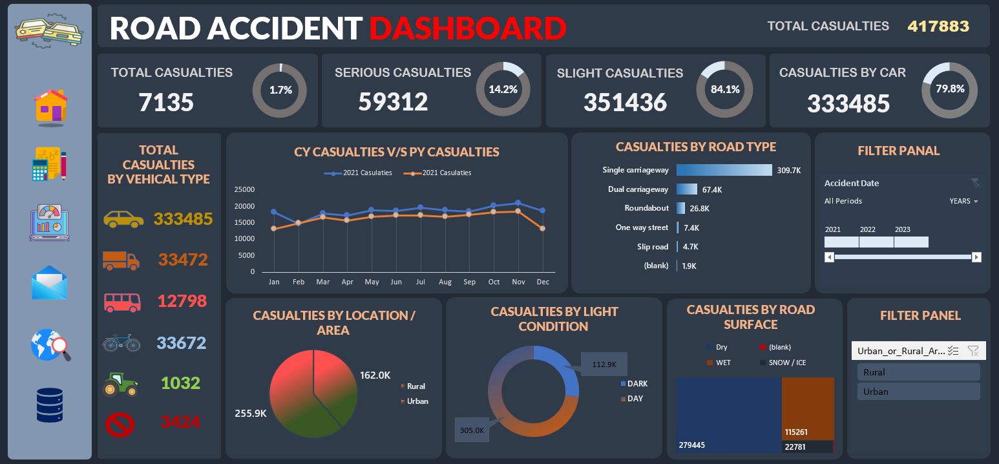
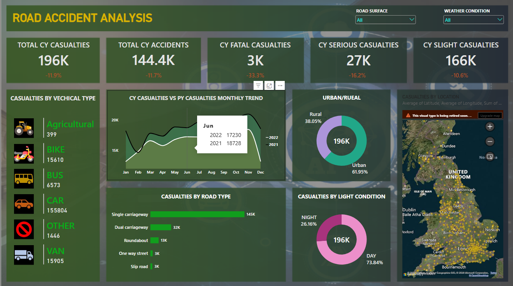

# Road-Accident-Analysis
Road Accident Analysis Dashboard Using Excel , SQL , Power BI

# Road Accident Analysis

## Project Overview

This project analyzes road accident data to identify patterns and trends
in casualties based on vehicle type, road type, road surface, location,
light conditions and accident severity.

## Tools Used

- Excel
- SQL
- Power BI

## Key Analysis

- Total casualties
- Serious casualties
- Slight casualties
- Casualties by vehicle type
- Casualties by road type
- Casualties by road surface
- Casualties by location
- Casualties by light condition
- Current Year vs Previous Year analysis

## Dashboard
EXCEL 

POWER BI 

## Project Files

- `Road_Accident_Dashboard.png` - Dashboard screenshot
- `Road_Accident_Analysis.xlsx` - Excel analysis
- `Road_Accident_Queries.sql` - SQL queries

## Skills Demonstrated

- Data Cleaning
- SQL
- Excel
- Power BI
- Data Analysis
- Data Visualization
- Dashboard Development
- KPI Analysis
