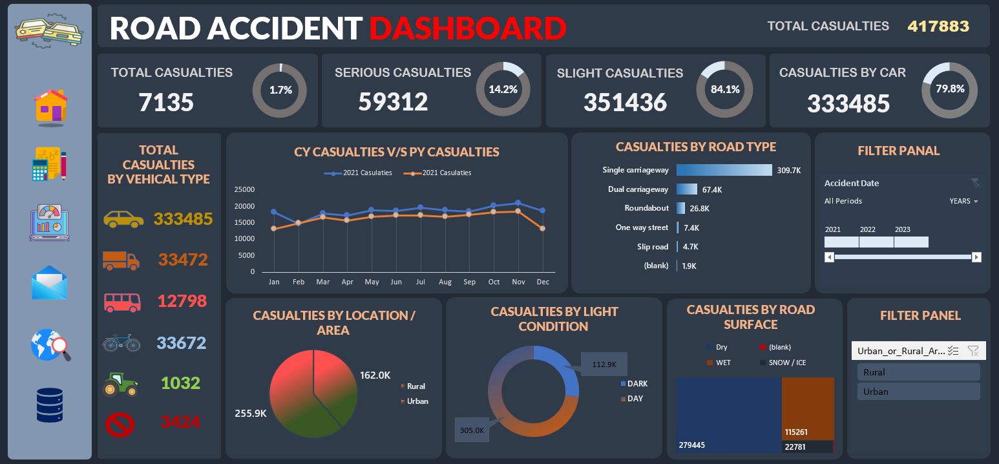
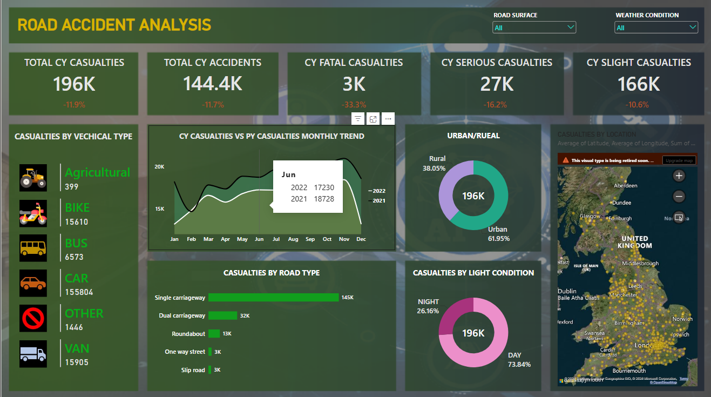

 🚗 Road Accident Analysis

## 📌 Project Overview

This project is an end-to-end *Road Accident Analysis* project developed using *SQL, Microsoft Excel, and Power BI*.

The objective is to analyze road accident casualties, identify accident patterns, compare *Current Year (CY)* with *Previous Year (PY)*, and understand the impact of factors such as vehicle type, road type, road surface, light conditions, urban/rural areas, weather conditions, and location.

##Dashboards

### 🔄 Project Workflow

*Raw Data → SQL Analysis → Excel Dashboard → Power BI Dashboard → Insights*

---

## 🛠️ Tools Used

- 🗄️ *SQL* – Data analysis and KPI calculations
- 📊 *Microsoft Excel* – Data analysis and dashboard creation
- 📈 *Power BI* – Interactive dashboard and visualization
- 💻 *GitHub* – Project documentation and portfolio

🧠 Skills Demonstrated

🗄️ SQL
SELECT
WHERE
GROUP BY
ORDER BY
SUM()
COUNT()
DISTINCT
CASE
YEAR()
DATENAME()
Subqueries
Percentage calculations

📊 Excel
Data Analysis
Dashboard Creation
KPI Reporting
Charts
Trend Analysis
Data Visualization

📈 Power BI
KPI Cards
Line Charts
Bar Charts
Donut Charts
Map Visualization
Slicers
Interactive Filters
Year-over-Year Analysis
Dashboard Design

## 🔍 SQL Analysis

SQL was used to perform the main analytical calculations on the road accident dataset.

The analysis includes:

- 📌 Current Year (2022) casualties
- 📌 Previous Year (2021) casualties
- 📌 Current Year total accidents
- 🔴 Fatal casualties
- 🟠 Serious casualties
- 🟢 Slight casualties
- 📊 Casualty percentage by severity
- 🚗 Casualties by vehicle type
- 📅 Monthly casualty trend
- 🛣️ Casualties by road type
- 🏙️ Urban vs Rural casualties
- 💡 Casualties by light condition
- 📍 Top 10 locations by casualties

### 🚘 Vehicle Classification

The detailed vehicle categories were grouped into:

- 🚗 Cars
- 🏍️ Bikes
- 🚌 Buses
- 🚐 Vans
- 🚜 Agricultural Vehicles
- 📦 Other

### 💡 Light Condition Classification

Light conditions were grouped into:

- ☀️ Day
- 🌙 Night

---

## 📊 Excel Dashboard

The Excel dashboard provides a visual summary of the road accident analysis.

### 📌 Main Analysis

- 📌 Total Casualties
- 🟠 Serious Casualties
- 🟢 Slight Casualties
- 🚗 Casualties by Vehicle Type
- 📅 Monthly Casualty Trend
- 🛣️ Casualties by Road Type
- 🏙️ Urban vs Rural Analysis
- 💡 Casualties by Light Condition
- 🛣️ Casualties by Road Surface
- 📍 Location-based Analysis

---

## 📈 Power BI Dashboard

The Power BI dashboard provides an interactive view of the road accident analysis.

### 📌 Key Performance Indicators

- 📊 Total CY Casualties
- 🚨 Total CY Accidents
- 🔴 CY Fatal Casualties
- 🟠 CY Serious Casualties
- 🟢 CY Slight Casualties

### 📊 Visualizations

- 🚗 Casualties by Vehicle Type
- 📅 CY vs PY Monthly Casualty Trend
- 🛣️ Casualties by Road Type
- 🏙️ Urban vs Rural Casualties
- 💡 Casualties by Light Condition
- 🛣️ Casualties by Road Surface
- 📍 Casualties by Location

### 🎛️ Interactive Filters

- 🛣️ Road Surface
- 🌦️ Weather Condition

---

## 📅 Current Year vs Previous Year

The project compares *2022 Current Year (CY)* casualties with *2021 Previous Year (PY)* casualties.

The monthly trend analysis helps identify changes in casualty levels throughout the year.

---

## 📍 Location Analysis

A *Top 10 Location Analysis* was performed using local authority information to identify locations with the highest number of casualties.

This helps highlight areas that may require further investigation and road-safety attention.

---

## 🎯 Key Objectives

- 🔎 Understand overall road accident casualty levels
- 🚗 Identify the most affected vehicle categories
- 🛣️ Identify high-risk road types
- 🏙️ Compare urban and rural casualties
- ☀️🌙 Analyze day vs night casualties
- 🛣️ Analyze road surface conditions
- 📍 Identify high-casualty locations
- 📅 Compare Current Year and Previous Year performance
- 📊 Present findings through interactive dashboards

---

## 🔄 Project Workflow

📂 Raw Road Accident Data
          ↓
🗄️ SQL Analysis
          ↓
📊 Excel Dashboard
          ↓
📈 Power BI Dashboard
          ↓
💡 Interactive Insights
